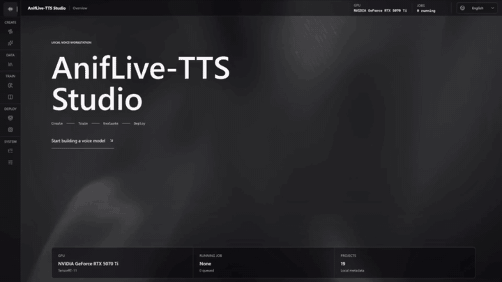

<div align="center">



# AnifLive-TTS

**A self-hosted, low-latency, high-quality multilingual voice-cloning TTS runtime**

[](RELEASE_NOTES_v1.5.0.md)
[](https://github.com/RVC-Boss/GPT-SoVITS)
[](https://developer.nvidia.com/cuda-toolkit)
[](https://docs.nvidia.com/deeplearning/tensorrt/)
[](docs/MACOS_INSTALLATION_EN.md)
[](LICENSING.md)

[繁體中文](README_ZH_HK.md) · **English** · [简体中文](README_ZH_CN.md)

</div>

## About the Project

AnifLive-TTS grew from a practical need: I wanted a multilingual TTS solution combining **low latency**, **high audio quality**, and self-hosted control. 😮‍💨

I therefore chose GPT-SoVITS as the foundation, reworked its inference internals, and made **low latency** and **high audio quality** the core goals of AnifLive-TTS. 🤓👆

The project now supports GPT-SoVITS v2ProPlus and v5Turbo through a shared API and model-package workflow.

## Highlights

- **v2ProPlus:** all nine neural stages use TensorRT 11 `execute_async_v3()`.
- **v5Turbo:** CUDA/TensorRT on Windows and native Rust/MLX/Metal on Apple Silicon, with 48 kHz output and four-step CFM.
- Putonghua/Mandarin (`zh`), Cantonese (`yue`), English (`en`), Japanese (`ja`), and Korean (`ko`), plus GPT-SoVITS flat and OpenAI-compatible adapters.
- Supports GPT-SoVITS v2ProPlus voice-cloning models, packaging custom GPT/SoVITS checkpoints and reference audio as independent voice profiles.
- Complete mono PCM16 WAV and low-latency PCM16 streaming share one runtime.
- Package-curated expression profiles support global and per-segment delivery without changing the v2ProPlus neural architecture.
- A local five-language WebUI provides model switching, natural-language expression selection, streaming playback, and live latency metrics.
- One-command v2ProPlus inspection, ONNX export, FP16 conversion, engine build, enqueue validation, and package publication in v1.
- Models and engines are prepared before service startup, keeping the `serve` hot path fully offline.

## Roxy Migurdia from *Mushoku Tensei: Jobless Reincarnation*: v2ProPlus Cantonese Demo

https://github.com/user-attachments/assets/0be5a03d-94a9-4d33-b05f-6bae6fb3cc40

The local WebUI shown in the demo is included in v1.3 and starts with `run_webui.bat` after the API is ready.

## Performance Benchmarks

For v1.5, the matched-input keep-alive audible TTFA P50/P95 was **75.70/99.37 ms** for v2ProPlus and **80.93/84.33 ms** for v5Turbo on Windows with an RTX 5070 Ti; v5Turbo on a Mac Studio M5 Max measured **404.69/410.78 ms**. See [Benchmarks](docs/BENCHMARKS.md) for the protocol and full results.

The following v1.3 historical benchmark uses the Roxy workload.

> [!NOTE]
> **Environment:** RTX 5070 Ti 16 GB / driver 596.36 / CUDA runtime 12.8 /
> PyTorch 2.7.0+cu128 / TensorRT 11.2.1.2 / FP16

The canonical v1.3 workload uses one external Roxy V2ProPlus voice package with fixed text, seed, and sampling parameters. It runs 10 sessions; every session performs 10 warmups, 100 complete-WAV requests, 100 streaming requests over new connections, and 100 streaming requests over one persistent connection. The headline is the median across the 10 session-level statistics. The range shows session variation. Miku is excluded from the performance headline because its known model-specific streaming behavior is being investigated separately.

Formal requests run at concurrency 1. New-connection rows open a local HTTP/1.1 connection per request; keep-alive rows reuse one separately warmed connection per session. First-packet latency ends when the client reads the first server-emitted PCM chunk. Audible TTFA uses the first PCM sample above -45 dBFS within the earliest active 10 ms RMS frame and is constrained by that chunk's arrival time. Device output latency is not included.

| Metric | Median across 10 session-level statistics | Session range |
|---|---:|---:|
| Complete REST WAV wall P50 | **153.177 ms** | 146.508–166.100 ms |
| Complete REST WAV wall P95 | **189.548 ms** | 158.981–201.439 ms |
| Server inference P50 | **148.591 ms** | 142.121–161.275 ms |
| RTF P50 | **0.087680** | 0.083863–0.095077 |
| Streaming first-packet latency P50 | **67.077 ms** | 64.866–74.544 ms |
| Streaming first-packet latency P95 | **90.853 ms** | 71.753–120.376 ms |
| Keep-alive streaming first-packet latency P50 | **67.953 ms** | 65.456–76.345 ms |
| Keep-alive streaming first-packet latency P95 | **92.019 ms** | 81.640–136.052 ms |
| Audible streaming TTFA P50 | **73.702 ms** | 71.491–81.169 ms |
| Audible streaming TTFA P95 | **97.478 ms** | 78.378–127.001 ms |
| Keep-alive audible streaming TTFA P50 | **74.578 ms** | 72.081–82.970 ms |
| Keep-alive audible streaming TTFA P95 | **98.644 ms** | 88.265–142.677 ms |
| GPU busy-time P50 | **53.0%** | 50.5–54% |
| GPU busy-time P95 | **56.0%** | 56–57% |

All 1,000 complete-WAV, 1,000 new-connection streaming, and 1,000 keep-alive streaming requests reported `TensorRT-11` with `X-PyTorch-Fallback: false`. See the machine-readable [`benchmarks/README_BENCHMARK_SUMMARY.json`](benchmarks/README_BENCHMARK_SUMMARY.json).

`nvidia-smi` reports interval GPU busy-time rather than SM occupancy. The serialized GPT autoregressive chain remains the primary reason utilization does not approach 100% at concurrency 1.

### Reproduce the benchmark table

[`scripts/benchmark_readme.py`](scripts/benchmark_readme.py) is the canonical public benchmark. Its Markdown output contains exactly the same 14 metrics as the table above, using the same default workload and aggregation method.

Run it against an existing local API:

```powershell
.\.venv\Scripts\python.exe .\scripts\benchmark_readme.py `
  --host 127.0.0.1 --port 9880 --locale en `
  --model roxy-v2proplus `
  --report .\reports\benchmark.json `
  --markdown .\reports\benchmark.md
```

Run it inside the existing Docker container without rebuilding or recreating it:

```powershell
docker exec aniflive-tts /app/scripts/entrypoint.sh benchmark `
  --host 127.0.0.1 --port 9880 --locale en `
  --model roxy-v2proplus `
  --report /data/reports/benchmark.json `
  --markdown /data/reports/benchmark.md
```

Defaults are 10 sessions per model, 10 warm-up requests per session, 100 complete-WAV requests, 100 new-connection streaming requests, and 100 keep-alive streaming requests. The release table used only `roxy-v2proplus`; every workload runs at concurrency 1.

### GPT-SoVITS Performance Comparison
The values below retain their original measurement types and hardware; the cited sources use different protocols.
#### First-output latency (lower is faster)
| System | Metric | First output | Test conditions | Source |
|---|---|---:|---|---|
| AnifLive-TTS v1.3 (historical) | Audible TTFA P50 | 74.578 ms | RTX 5070 Ti; persistent HTTP/1.1; 10 Roxy sessions | [Historical local measurement](benchmarks/README_BENCHMARK_SUMMARY.json) |
| AnifLive-TTS v1.5 v2ProPlus | Audible TTFA P50 | 75.70 ms | Windows; RTX 5070 Ti; TensorRT 11 FP16; keep-alive PCM; 10 sessions | [v1.5 local measurement](benchmarks/V1_5_BENCHMARK_SUMMARY.json) |
| AnifLive-TTS v1.5 v5Turbo | Audible TTFA P50 | 80.93 ms | Windows; RTX 5070 Ti; TensorRT 11 / Triton FP16; keep-alive PCM; 10 sessions | [v1.5 local measurement](benchmarks/V1_5_BENCHMARK_SUMMARY.json) |
| gsv.cpp v0.1.3 · v5Turbo | Audible TTFA P50 | 354.45 ms | RTX 5070 Ti; Vulkan; keep-alive PCM; 3-session exploratory run | [v1.5 local measurement](benchmarks/V1_5_BENCHMARK_SUMMARY.json) |
| AnifLive-TTS v1.5 v5Turbo (M5 Max) | Audible TTFA P50 | 404.69 ms | Mac Studio M5 Max; macOS 27.0; Rust / MLX / Metal FP16; keep-alive PCM; 10 sessions | [v1.5 local measurement](benchmarks/V1_5_BENCHMARK_SUMMARY.json) |
| GPT-SoVITS C++ TRT Stream | First packet | 460 ms | RTX 2080 Ti 22 GB | [GPT-SoVITS C++](https://github.com/GPT-SoVITS-Devel/GPT-SoVITS-cpp#-performance-benchmarks) |
| GPT-SoVITS Minimal Inference ONNX Stream | First token | 1,000 ms | RTX 2080 Ti 22 GB; FP16 | [Minimal Inference](https://github.com/GPT-SoVITS-Devel/GPT-SoVITS_minimal_inference#-performance-benchmarks) |
| GPT-SoVITS Minimal Inference TRT fitted | First token | 2,022 ms | RTX 2080 Ti 22 GB; FP16 | [Minimal Inference](https://github.com/GPT-SoVITS-Devel/GPT-SoVITS_minimal_inference#-performance-benchmarks) |

#### RTF (lower is faster)
| System | RTF | Backend / model | Test conditions | Source |
|---|---:|---|---|---|
| GPT-SoVITS v2ProPlus | 0.014 | PyTorch parallel inference | RTX 4090; about four minutes of output | [RVC-Boss/GPT-SoVITS](https://github.com/RVC-Boss/GPT-SoVITS#features) |
| GPT-SoVITS v2ProPlus | 0.028 | PyTorch parallel inference | RTX 4060 Ti | [RVC-Boss/GPT-SoVITS](https://github.com/RVC-Boss/GPT-SoVITS#features) |
| AnifLive-TTS v1.5 v5Turbo | 0.04728 | TensorRT 11 / Triton FP16 | Windows; RTX 5070 Ti; keep-alive PCM; 10 sessions | [v1.5 local measurement](benchmarks/V1_5_BENCHMARK_SUMMARY.json) |
| AnifLive-TTS v1.3 (historical) | 0.087680 | TensorRT 11 FP16 | RTX 5070 Ti; 10 Roxy sessions | [Historical local measurement](benchmarks/README_BENCHMARK_SUMMARY.json) |
| AnifLive-TTS v1.5 v2ProPlus | 0.09483 | TensorRT 11 FP16 | Windows; RTX 5070 Ti; keep-alive PCM; 10 sessions | [v1.5 local measurement](benchmarks/V1_5_BENCHMARK_SUMMARY.json) |
| GPT-SoVITS C++ TRT | 0.1020 | TensorRT | RTX 2080 Ti 22 GB | [GPT-SoVITS C++](https://github.com/GPT-SoVITS-Devel/GPT-SoVITS-cpp#-performance-benchmarks) |
| gsv.cpp v0.1.3 · v5Turbo | 0.11197 | Vulkan; F16 AR / F32 vocoder | RTX 5070 Ti; 3-session exploratory run | [v1.5 local measurement](benchmarks/V1_5_BENCHMARK_SUMMARY.json) |
| GPT-SoVITS Minimal Inference TRT fitted | 0.2096 | TensorRT fitted | RTX 2080 Ti 22 GB; FP16 | [Minimal Inference](https://github.com/GPT-SoVITS-Devel/GPT-SoVITS_minimal_inference#-performance-benchmarks) |
| AnifLive-TTS v1.5 v5Turbo (M5 Max) | 0.32357 | Rust / MLX / Metal FP16 | Mac Studio M5 Max; macOS 27.0; keep-alive PCM; 10 sessions | [v1.5 local measurement](benchmarks/V1_5_BENCHMARK_SUMMARY.json) |

### Public Performance Data from Other Open-Source TTS Systems
The values below retain their original measurement types and hardware; the cited sources use different protocols.
#### First-audio latency (lower is faster)
| System | First-audio metric | First audio | Statistic | Test conditions | Source |
|---|---|---:|---|---|---|
| AnifLive-TTS v1.3 (historical) | Audible TTFA | 74.578 ms | P50 | RTX 5070 Ti; persistent HTTP/1.1; 10 Roxy sessions | [Historical local measurement](benchmarks/README_BENCHMARK_SUMMARY.json) |
| AnifLive-TTS v1.5 v2ProPlus | Audible TTFA | 75.70 ms | P50 | Windows; RTX 5070 Ti; keep-alive PCM; 10 sessions | [v1.5 local measurement](benchmarks/V1_5_BENCHMARK_SUMMARY.json) |
| AnifLive-TTS v1.5 v5Turbo | Audible TTFA | 80.93 ms | P50 | Windows; RTX 5070 Ti; keep-alive PCM; 10 sessions | [v1.5 local measurement](benchmarks/V1_5_BENCHMARK_SUMMARY.json) |
| Qwen3-TTS-12Hz-0.6B | First-packet latency | 97 ms | Concurrency 1 | Single accelerator; 320 ms speech packet | [Qwen3-TTS Technical Report](https://arxiv.org/abs/2601.15621) |
| Fish Audio S2 | TTFA | About 100 ms | Project-published value | H200; single GPU | [Fish Audio S2](https://github.com/fishaudio/fish-speech#performance) |
| Chatterbox-Flash (D=32, α=0.75) | TTFP | 103 ms | Concurrency 1; 50 utterances | H100 | [Chatterbox-Flash paper](https://arxiv.org/abs/2605.30748) |
| Chatterbox-Flash (default D=16, α=0.5) | TTFP | 118 ms | Concurrency 1; 50 utterances | H100 | [Chatterbox-Flash paper](https://arxiv.org/abs/2605.30748) |
| CosyVoice2 | First chunk | 196.13 ms | P50 | L20; concurrency 1; client-server | [QwenAudio/CosyVoice](https://github.com/QwenAudio/CosyVoice/blob/main/runtime/triton_trtllm/README.Cosyvoice2.DiT.md#benchmark-with-client-server-mode) |

#### RTF (lower is faster)
| System | RTF | Runtime / model | Test conditions | Source |
|---|---:|---|---|---|
| AnifLive-TTS v1.5 v5Turbo | 0.04728 | TensorRT 11 / Triton FP16 | Windows; RTX 5070 Ti; 10 sessions | [v1.5 local measurement](benchmarks/V1_5_BENCHMARK_SUMMARY.json) |
| Chatterbox-Flash (D=32, α=0.75) | 0.076 | Block diffusion | H100; concurrency 1; 50 utterances | [Chatterbox-Flash paper](https://arxiv.org/abs/2605.30748) |
| AnifLive-TTS v1.3 (historical) | 0.087680 | TensorRT 11 FP16 | RTX 5070 Ti; 10 Roxy sessions | [Historical local measurement](benchmarks/README_BENCHMARK_SUMMARY.json) |
| AnifLive-TTS v1.5 v2ProPlus | 0.09483 | TensorRT 11 FP16 | Windows; RTX 5070 Ti; 10 sessions | [v1.5 local measurement](benchmarks/V1_5_BENCHMARK_SUMMARY.json) |
| Chatterbox-Flash (default D=16, α=0.5) | 0.107 | Block diffusion | H100; concurrency 1; 50 utterances | [Chatterbox-Flash paper](https://arxiv.org/abs/2605.30748) |
| CosyVoice3 | 0.1091 | TRT-LLM; offline batch 1 | L20 | [QwenAudio/CosyVoice](https://github.com/QwenAudio/CosyVoice/blob/main/runtime/triton_trtllm/README.Cosyvoice3.md#benchmark-with-offline-inference-mode) |
| CosyVoice2 | 0.1228 | TRT-LLM | L20; concurrency 1; client-server | [QwenAudio/CosyVoice](https://github.com/QwenAudio/CosyVoice/blob/main/runtime/triton_trtllm/README.Cosyvoice2.DiT.md#benchmark-with-client-server-mode) |
| VoxCPM2 | About 0.13 | Nano-vLLM / vLLM-Omni | RTX 4090 | [OpenBMB/VoxCPM](https://github.com/OpenBMB/VoxCPM#-highlights) |
| Fish Audio S2 | 0.195 | SGLang-based inference engine | H200; single GPU | [Fish Audio S2](https://github.com/fishaudio/fish-speech#performance) |
| IndexTTS 2.5 | 0.2065 | 2.5 BF16; KV cache | RTX 4090; overall | [index-tts/index-tts](https://github.com/index-tts/index-tts#-inference-speed) |
| Qwen3-TTS-12Hz-0.6B | 0.288 | vLLM V0; concurrency 1 | Single accelerator; CUDA Graph | [Qwen3-TTS Technical Report](https://arxiv.org/abs/2601.15621) |
| IndexTTS 2.0 | 0.3257 | 2.0 FP16; KV cache | RTX 4090; overall | [index-tts/index-tts](https://github.com/index-tts/index-tts#-inference-speed) |


## Deterministic Quality Preservation

> [!NOTE]
> **Quality gate**　Each controlled-expression stream is compared with its complete-WAV output at the same seed and settings. Neutral complete WAV, streaming PCM, and semantic outputs are also checked against the immutable v1.2 baseline. These objective checks do not replace subjective listening.

| Voice package | Japanese expression rows | Minimum log-mel | Minimum speaker cosine | Maximum duration difference | Underruns |
|---|---:|---:|---:|---:|---:|
| Miku v2ProPlus | 18/18 | 0.999454 | 0.989519 | 0.302% | 0 |
| Roxy v2ProPlus | 18/18 | 0.994325 | 0.987721 | 0.300% | 0 |

These rows describe private local validation overlays only. Their expression
references, transcripts, and character media are not included in the public
source, image, or release bundle.

The post-policy five-language long/short matrix passed 20/20 rows per model. Its controlled-expression minima were `0.999660` log-mel and `0.988638` speaker cosine for Miku, and `0.998827` and `0.993495` for Roxy. Neutral complete WAV, streaming PCM, complete semantics, and streaming semantics remain exactly equal to v1.2 for both packages across `zh`, `yue`, `en`, `ja`, and `ko`.

Six independent short, long, and mixed-expression blind pairs produced five no-difference decisions, one preference for the Roxy complete output, and no reported artifact. The hard gates remain log-mel cosine `>=0.99`, speaker cosine `>=0.98`, and duration difference `<=3%`.

## Optimizations And Tested Boundary

- All nine neural stages execute through TensorRT 11 `execute_async_v3()`.
- Per-model fitted GPT engines use persistent TensorRT contexts, fixed KV buffers, and zero auxiliary streams.
- A sampling CUDA Graph captures softmax, multinomial, and gather while preserving RNG semantics.
- Only the first text segment uses the established 9+8 semantic-token preview; later segments keep the native full-context refill path.
- EOS checks remain batched every two steps, and the runtime retains its warm state for 25 seconds.
- Expression references are prepared at model activation and kept GPU-resident; neutral requests preserve the v1.2 output exactly.
- Expression selection and transition settings are package-driven, with no Miku/Roxy runtime branch.
- Startup warmup and HTTP/1.1 keep-alive avoid request-time setup.

Full GPT-step CUDA Graph capture is currently limited by TensorRT capture
compatibility. See the [performance engineering record](docs/PERFORMANCE_ENGINEERING.md).

## Architectures Evaluated for v1.2

| Candidate | Result | Decision |
|---|---|---|
| Transformer + TensorRT runtime optimization | Passed end-to-end latency and quality gates | Adopted |
| MTP-4 | Future-token accuracy did not meet the semantic quality gate | Not adopted |
| Mamba-2 hybrid | End-to-end benefit did not justify the quality and complexity tradeoff | Not adopted |
| Mamba-2 hybrid + MTP | Combined quality/performance gate was not met | Not adopted |

AnifLive-TTS does not adopt architectural changes solely for theoretical
efficiency. Experimental semantic backends are promoted only when they
outperform the production baseline without compromising speech quality. See
the [v1.2 semantic experiment record](docs/research/v1.2-semantic-experiments.md).

## Architectures Evaluated for v1.3

| Candidate | Result | Decision |
|---|---|---|
| Reference-directed expression control | Passed objective, compatibility, and blind-listening gates | Adopted |
| Hard-token acoustic lookahead with MTP future context | Cross-model quality and end-to-end latency gates were not met | Not adopted |
| Early-exit Transformer self-draft | Even one draft token made the first-17 path 50-61% slower because drafting cost exceeded the verification savings | Not adopted |
| Recurrent speculative decoding | Reduced target NFE, but drafter and verifier overhead limited wall-time benefit | Not adopted |
| SemanticPiece / EABPE | Sequence compression did not concentrate in the first 17 TTFA-critical tokens | Not adopted |
| Retrieval-based speculative decoding | The offline oracle found no candidate that met all first-17 coverage gates | Not adopted |
| FastStart distilled/pruned Transformer | Continuation and refill reliability gates were not met | Not adopted |
| D16 block diffusion | The evaluated low-rank adaptation did not pass the semantic-quality gate | Not adopted |

See the [v1.3 latency experiment record](docs/research/v1.3-latency-experiments.md) and [expression design record](docs/research/v1.3-reference-expression-design.md).

## Studio Added in v1.4

Studio adds dataset preparation and review, training, checkpoint continuation, TensorRT conversion, evaluation and model installation.

| Feature | Result | Version |
|---|---|---|
| Studio dataset preparation and review | Functional workflow verified | Added in v1.4 |
| Studio training, checkpoint continuation and GPU handoff | Real training and recovery verified | Added in v1.4 |
| Studio TensorRT conversion, evaluation and model installation | Package and listening gates verified | Added in v1.4 |

For step-by-step instructions, see the [Studio user guide](docs/ANIFLIVE_TTS_STUDIO_GUIDE.md).

## Python SDK Added in v1.5-beta

The official Rust-backed Python SDK provides sync/async discovery, WAV synthesis, incremental PCM streaming, expressions, and speech sessions. Install the supplied wheel for your platform and connect to the existing API; no local model or GPU is needed by the client.

```python
from aniflive_tts import Client

with Client("http://127.0.0.1:9880") as client:
    client.probe()
    result = client.synthesize(text="今日はいい天気ですね。", language="ja")
    with open("speech.wav", "wb") as output:
        output.write(result.audio)
```

See the [SDK manual](docs/SDK_EN.md) for download, installation, usage examples, asynchronous streaming, session lifecycle, and error handling. WebUI and Studio remain available alongside the SDK.

## v1.5: v5Turbo and Native Apple Silicon

v1.5 adds GPT-SoVITS v5Turbo and native Apple Silicon support. On Windows, v5Turbo uses the CUDA/TensorRT backend; on macOS, the native worker uses Rust, MLX and Metal with FP16 or FP32. Voice and Reference management supports zero-shot use, and registered voices can use whole-sentence and per-segment expression controls. Speech Session policy A supports append, flush and cancellation; policies B–F remain experimental.

Mac streaming emits vocoder PCM incrementally after semantic generation and CFM complete. See the [Mac installation guide](docs/MACOS_INSTALLATION_EN.md) and [platform matrix](docs/V1_5_PLATFORM_MATRIX.md) for setup.

## Architecture And API

AnifLive-TTS provides a self-hosted speech inference API for `gsv-v2proplus` and `gsv-v5turbo`. Python handles the API, five-language frontend and model packages. On Windows, CUDA/TensorRT executes the v2ProPlus model stages and accelerates v5Turbo; the macOS V5 backend uses a native MLX/Metal worker. One process preloads one active model.

- Languages: Putonghua/Mandarin (`zh`), Cantonese (`yue`), English (`en`), Japanese (`ja`), and Korean (`ko`); legacy adapters also accept `auto` and `auto_yue`.
- Canonical endpoint: `POST /v1/audio/speech`.
- Discovery: `GET /health`, `/v1/capabilities`, `/v1/models`, `/v1/voices`.
- Expression discovery: `GET /v1/expressions`; global and per-segment expression requests use the canonical speech endpoint.
- Model selection: `POST /v1/models/activate` unloads the active package before loading one compatible local replacement.
- Cancellation: `POST /v1/audio/cancel` releases an abandoned stream before the next request.
- `stream=false` returns mono PCM16 WAV; `stream=true` returns PCM16 chunks.
- Studio: full workstation for datasets, target-speaker extraction, training, conversion, evaluation, models and jobs; launch with `run_studio_docker.bat` at `http://127.0.0.1:9891/`.
- WebUI: the coexisting lightweight interface for model selection, expression control and speech playback; launch with `run_webui.bat` at `http://127.0.0.1:9890/`.
- Studio jobs support progress reporting, epoch-boundary training pause/resume and managed GPU handoff.

See the [Studio guide](docs/ANIFLIVE_TTS_STUDIO_GUIDE.md) for the complete workflow and the [training pipeline](docs/V1_4_TRAINING_PIPELINE.md) for checkpoint and qualification details.

## Quick Start

The five steps below describe the Windows v2ProPlus workflow. Users with an existing GPT-SoVITS voice-cloning model can convert its GPT/SoVITS checkpoints and reference audio directly into an AnifLive-TTS model package. For Apple Silicon, see the [Mac installation guide](docs/MACOS_INSTALLATION_EN.md).

### 1. Install the local toolchain

Create the project environment before installing anything. The API never installs
dependencies or downloads shared assets at startup.

```powershell
py -3.11 -m venv .venv
.\.venv\Scripts\python.exe -m pip install -r requirements\torch-cu128.txt
.\.venv\Scripts\python.exe -m pip install -r requirements\base.txt
.\.venv\Scripts\python.exe -m pip install -r requirements\tensorrt11-cu12.txt
.\.venv\Scripts\python.exe -m pip install -e ".[runtime]"
.\.venv\Scripts\python.exe scripts\setup_shared_assets.py `
  --output D:\models\shared --accept-third-party-licenses
```

For the CUDA 12.6 profile, replace `requirements\torch-cu128.txt` with
`requirements\torch-cu126.txt`. Review [THIRD_PARTY_NOTICES.md](THIRD_PARTY_NOTICES.md)
before accepting the shared-asset licenses.

### 2. Convert a model

```powershell
.\.venv\Scripts\aniflive-tts.exe model convert `
  --gpt D:\models\voice.ckpt --sovits D:\models\voice.pth `
  --reference-audio D:\models\reference.wav `
  --reference-text-file D:\models\reference.txt --reference-language ja `
  --model-id my-v2proplus --voice-profile default `
  --shared-dir D:\models\shared --output D:\models\my-v2proplus
```

The converter inspects checkpoint headers and tensor shapes, exports ONNX,
converts FP16, applies TensorRT 11 graph patches, builds fitted engines,
validates deserialize/enqueue, and atomically publishes the package.

> [!IMPORTANT]
> Safe mode uses `torch.load(weights_only=True)`. Use `--allow-unsafe-pickle` only with a trusted local checkpoint.

Engine fingerprints include TensorRT,
CUDA runtime, compute capability, ONNX, profiles, and build configuration.

Expression control is optional. The public source, image, and release bundle ship
without predefined expression profiles or reference media. Create a specification
for references that you have the right to use:

```json
{
  "schema": 1,
  "default_profile": "neutral",
  "preferred_policy": "semantic-style",
  "profiles": [
    {
      "id": "gentle-1",
      "emotion": "gentle",
      "intensity": 0.7,
      "reference_audio": "gentle.wav",
      "reference_text": "This transcript must exactly match the reference audio.",
      "reference_language": "en",
      "manual_verified": true
    }
  ]
}
```

Then add the verified references without modifying the source package:

```powershell
.\.venv\Scripts\aniflive-tts.exe model import-expressions `
  --model-package D:\models\my-v2proplus `
  --voice-profile default `
  --spec-file D:\models\expressions.json `
  --asset-root D:\models\expression-audio `
  --output D:\models\my-v2proplus-expression
```

The importer is model-ID agnostic and uses package metadata, so any validated v2ProPlus package follows the same contract.
Use clean, single-speaker WAV files and exact transcripts. The importer copies the
assets into the new output package, updates checksums, and leaves the original
neutral package unchanged.

### 3. Validate real engine enqueue

> [!TIP]
> Validate every newly converted model package with `--enqueue` before starting the API.

```powershell
.\.venv\Scripts\aniflive-tts.exe validate `
  --model-package D:\models\my-v2proplus `
  --shared-dir D:\models\shared `
  --enqueue
```

### 4. Start the Docker API

```powershell
Copy-Item .env.example .env
```

For the example paths above, set these values in `.env` before starting:

```dotenv
ANIFLIVE_TTS_HOST_PORT=9880
ANIFLIVE_TTS_MODELS_DIR=D:/models
ANIFLIVE_TTS_MODEL_PACKAGE=/data/models/my-v2proplus
ANIFLIVE_TTS_SHARED_HOST_DIR=D:/models/shared
```

```powershell
.\scripts\run_docker.ps1 -CudaProfile cu128 -Build
```

Use `-Build` for the first image build; later starts reuse that image. Model and
cache directories persist through host bind mounts. See the [deployment guide](docs/DEPLOYMENT_EN.md).

The default Compose configuration exposes the API on loopback only. AnifLive-TTS
does not provide public-edge authentication; place any external deployment behind
an authenticated reverse proxy and appropriate request limits.

### 5. Start the local WebUI

```powershell
.\run_webui.bat
```

After activating a package with expression profiles, highlight a complete clause
including its comma, period, semicolon, question mark, or exclamation mark, then
choose an expression. Unmarked text uses the voice's native neutral delivery.
Packages without imported profiles keep the expression UI unavailable.

## API

```powershell
curl.exe -X POST "http://127.0.0.1:9880/v1/audio/speech" `
  -H "Content-Type: application/json" `
  --output output.wav `
  --data '{"model":"my-v2proplus","voice_profile":"default","text":"今日はいい天気ですね。","language":"ja","stream":false,"generation":{"top_k":15,"top_p":1.0,"temperature":1.0,"seed":1234}}'
```

For one expression, add a symbolic profile returned by `GET /v1/expressions`:

```json
{
  "model": "my-v2proplus",
  "text": "The weather is nice today.",
  "language": "en",
  "stream": true,
  "expression": {
    "enabled": true,
    "profile": "gentle",
    "intensity": 0.7,
    "policy": "semantic-style"
  }
}
```

For multiple expressions, send complete, punctuation-terminated clauses. The
server rejects mid-phrase switches rather than risk skipped or unclear words:

```json
{
  "model": "my-v2proplus",
  "language": "en",
  "stream": true,
  "segments": [
    {
      "text": "I was worried, ",
      "expression": {"enabled": true, "profile": "shy", "intensity": 0.6}
    },
    {
      "text": "but now I am ready.",
      "expression": {"enabled": true, "profile": "confident", "intensity": 0.8}
    }
  ]
}
```

| Endpoint | Purpose |
|---|---|
| `POST /v1/audio/speech` | Canonical TTS and OpenAI adapter |
| `GET/POST /` | GPT-SoVITS flat compatibility adapter |
| `GET /health` | Readiness, GPU, CUDA, TensorRT, and engine proof |
| `GET /v1/capabilities` | Languages, streaming, and expression capability |
| `GET /v1/models` | Active model |
| `POST /v1/models/activate` | Switch to a compatible local model package |
| `GET /v1/voices` | Startup-cached voice profiles |
| `GET /v1/expressions` | Package-curated expression profiles and policies |
| `POST /v1/audio/cancel` | Cancel the active stream |

## Roadmap

**v1.3**

- [x] v2ProPlus model conversion and nine-stage TensorRT 11 inference
- [x] Five-language API, complete WAV, low-latency PCM streaming, and Docker delivery
- [x] Package-curated expression profiles, per-segment delivery, and the local WebUI

**v1.4 — Studio**

- [x] Studio dataset preparation, review and target-speaker extraction
- [x] Studio training, checkpoint continuation, TensorRT conversion and evaluation
- [x] Studio model installation, job management and GPU handoff

**v1.5-beta**

- [x] Rust-backed Python SDK with synchronous and asynchronous clients

**v1.5**

- [x] v5Turbo inference with shared-base model support
- [x] Native Apple Silicon backend and macOS installation path

**Next: GPT-SoVITS Model Generations**

- [ ] Support v5Pro and more future GPT-SoVITS models under the same API and model-package contract

**Later: Neural Emotion Adapter**

- [ ] Implement controllable emotion, intensity, and style with timbre-preservation and latency acceptance

## Compatibility

> [!WARNING]
> **Before deployment**　`cu128` is the configuration with complete local GPU E2E validation. The `cu126` compatibility profile has source and build-policy validation only; GPU E2E support is not claimed until its image passes the release workflow and validation on a compatible host.

Windows supports v2ProPlus and v5Turbo; the native Apple Silicon backend supports v5Turbo. Use `cu128` for RTX 50-series/Blackwell GPUs. `cu126` has not passed end-to-end GPU validation on the RTX 5070 Ti; see the [deployment guide](docs/DEPLOYMENT_EN.md) and [Mac installation guide](docs/MACOS_INSTALLATION_EN.md).

## Documentation And License

- [API contract](docs/API_EN.md)
- [Deployment guide](docs/DEPLOYMENT_EN.md)
- [Native macOS installation](docs/MACOS_INSTALLATION_EN.md)
- [Performance engineering record](docs/PERFORMANCE_ENGINEERING.md)
- [Acceptance report](docs/ACCEPTANCE.md)
- [Rollback guide](docs/ROLLBACK.md)
- [Licensing](LICENSING.md)
- [Third-party notices](THIRD_PARTY_NOTICES.md)
- [Third-party media notice](assets/THIRD_PARTY_MEDIA.md)

AnifLive-TTS builds on the research and engineering of [GPT-SoVITS](https://github.com/RVC-Boss/GPT-SoVITS), [GPT-SoVITS Minimal Inference](https://github.com/GPT-SoVITS-Devel/GPT-SoVITS_minimal_inference), and [GPT-SoVITS C++](https://github.com/GPT-SoVITS-Devel/GPT-SoVITS-cpp). Special thanks to GPT-SoVITS creator **花儿不哭** and all other GPT-SoVITS contributors.

Original AnifLive-TTS code is licensed under [PolyForm Noncommercial 1.0.0](LICENSE); commercial use requires a separate written Commercial License from Hiruynk. GPT-SoVITS-derived portions retain MIT, Minimal Inference-derived and applicable GPT-SoVITS C++ reference portions retain Apache-2.0, and dependencies retain their own terms. See [LICENSING.md](LICENSING.md) and [THIRD_PARTY_NOTICES.md](THIRD_PARTY_NOTICES.md).
